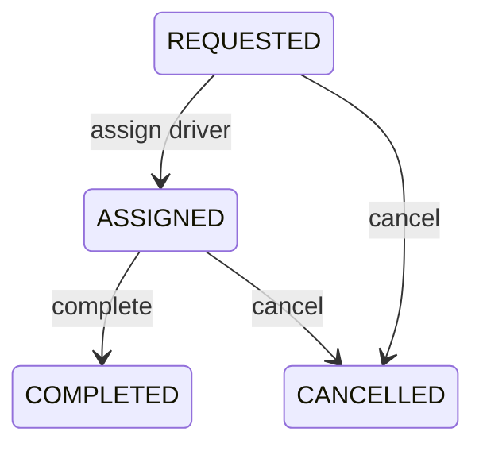

# RideWise

RideWise is a milestone-based Java console application for learning object-oriented design, low-level design, validation, collections, strategies, lifecycle modeling, and relational database concepts.

The application stores data in memory and supports the complete console MVP:

- Register riders and drivers with generated IDs.
- List available drivers.
- Request and store rides, including unmatched requests.
- Match the nearest available driver.
- Complete rides and calculate vehicle-specific fares.
- Generate immutable fare receipts.
- Release drivers after completion.
- List current and historical rides.

Cancellation, peak pricing, and least-active matching are implemented in the domain and service layers but are not exposed through the required initial menu.

## Requirements

- JDK 17 or newer

No build framework or external library is required.

## Run the application

From the project root:

```sh
javac -d out $(find src -name '*.java')
java -cp out com.airtribe.ridewise.Main
```

The menu provides:

```text
1. Add Rider
2. Add Driver
3. View Available Drivers
4. Request Ride
5. Complete Ride
6. View Rides
7. Exit
```

Generated IDs use these process-local sequences:

```text
RIDER-001
DRIVER-001
RIDE-001
```

IDs and stored data reset when the application restarts.

## Agreed domain rules

- Location is a finite numeric position along a shared reference road. Negative positions are valid.
- Driver-to-rider distance is the absolute difference between their locations.
- Trip distance must be finite and greater than zero.
- An unmatched ride remains stored as `REQUESTED` with a null driver.
- Equal nearest-driver distances are resolved by the lower driver ID.
- Least-active means the fewest completed rides, followed by nearest distance and driver ID.
- A driver becomes unavailable after assignment and available after completion or cancellation.
- A receipt is generated once, when an assigned ride completes.

Default fares are:

| Vehicle | Base fare | Per distance unit |
|---|---:|---:|
| `BIKE` | 20.0 | 8.0 |
| `AUTO` | 30.0 | 12.0 |
| `CAR` | 50.0 | 18.0 |

Peak pricing multiplies the base strategy result by `1.5` during `08:00–10:00` and `17:00–20:00`. The default time zone is `Asia/Kolkata`, and each end time is exclusive.

## Ride lifecycle



Other transitions throw `InvalidRideStateException`. Rejected operations validate before mutation so they preserve the prior ride and driver state.

## Design

- Models protect valid state and represent riders, drivers, rides, and receipts.
- Services own registration, lookup, storage, availability, fare validation, and ride workflows.
- `RideMatchingStrategy` supports nearest and least-active matching.
- `FareStrategy` supports default vehicle pricing and composed peak pricing.
- The State pattern places transition permissions in one class per ride state.
- `DataStore<T extends Identifiable>` centralizes in-memory map operations.
- `Main` handles console parsing, output, exception recovery, and application wiring.

Key tradeoffs:

- The State pattern makes transitions explicit but adds several small classes.
- The singleton ID generator provides one in-process sequence but introduces global mutable state and restart collisions.
- `completedRideCount` makes least-active matching cheap but duplicates information that could be derived from completed rides.
- The required fare contract uses `double`; production monetary code should normally use `BigDecimal` and database `DECIMAL` columns.

## Project structure

```text
src/com/airtribe/ridewise/
├── Main.java
├── exception/    focused domain exceptions
├── model/        Rider, Driver, Ride, FareReceipt, and enums
├── service/      registration, storage-facing, fare, and ride workflows
├── state/        ride lifecycle states
├── strategy/     matching and fare strategies
└── util/         DataStore and IdGenerator
```

## Relational design notes

The application currently uses in-memory object references. A relational implementation would use four core tables:

- `riders`, keyed by rider ID
- `drivers`, keyed by driver ID
- `rides`, with a required rider foreign key and nullable driver foreign key
- `fare_receipts`, using ride ID as both primary key and foreign key

Ride rows should snapshot pickup and drop-off locations instead of relying on mutable rider or driver locations. The current console collects trip distance but no destination, so a persistence implementation must first define how drop-off position is supplied.

Assignment, completion, and cancellation require transactions in a database version. Driver availability alone cannot prevent concurrent double booking; row locking or a conditional update such as `UPDATE ... WHERE available = true` is required.

## Intentional scope limits

The MVP does not implement:

- Durable persistence or database integration
- Real maps or GPS distance
- Payments
- Networking
- Production concurrency
- Durable or distributed ID generation
- Runtime strategy configuration in the console

These are separate extensions rather than requirements of the learning MVP.
